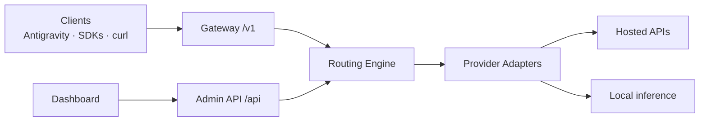

# ModelForge

**Universal AI Provider Management, Model Gateway & Antigravity Integration Platform**

Connect every AI provider you use — hosted APIs and local inference alike —
discover and manage their models in one registry, test them honestly, and
route traffic through a single OpenAI-compatible gateway with fallbacks,
circuit breakers and cost tracking. Built for individual developers and AI
infrastructure teams.

> ModelForge is an independent open-source project. It was inspired by the
> publicly documented functionality of tools like `antigravity-add-model`
> (registering custom models for Google Antigravity) but is a substantially
> larger, original platform. It does not patch Antigravity binaries or use
> private APIs — integration works through the local gateway endpoint.

## Highlights

- **25 providers out of the box** — OpenAI, Anthropic, Google Gemini, OpenRouter,
  DeepSeek, Groq, Mistral, xAI, Together, Fireworks, Cerebras, SambaNova,
  SiliconFlow, Novita, Hugging Face, NVIDIA NIM, Alibaba Model Studio,
  Cloudflare Workers AI, plus Ollama, LM Studio, vLLM, llama.cpp, LocalAI and
  Text Generation WebUI. New OpenAI-compatible providers are one-line catalog
  entries.
- **Honest diagnostics** — 9 independently reported stages (config, DNS, auth,
  model listing, model access, generation, streaming, tool calling,
  timeout/retry). A provider is never called "tested" just because listing worked.
- **Intelligent gateway** — OpenAI-compatible `/v1` API with aliases,
  fallback chains (`chain:<id>`), routing policies (`policy:<id>`:
  explicit / lowest-latency / lowest-cost / round-robin), bounded retries and
  per-connection circuit breakers.
- **Secure by default** — API keys encrypted at rest (AES-256-GCM), masked in
  every API response, never exported, never logged. SSRF guard on upstream
  URLs, loopback binding, optional gateway/admin keys.
- **Full observability** — token usage (provider-reported vs estimated, always
  labeled), latency, TTFT, estimated costs from configured pricing,
  Prometheus metrics at `/metrics`, structured logs with correlation ids.
- **Local GPU infrastructure** — inference-server registry with health checks
  and `nvidia-smi` GPU/CUDA detection. Distributed inference is delegated to
  mature runtimes (vLLM, Ollama) — never reimplemented.

## Quick start

```bash
npm install
npm run dev:gateway     # gateway + API on http://127.0.0.1:8787
npm run build:dashboard # then open http://127.0.0.1:8787/ui/
# or develop the dashboard with hot reload:
npm run dev:dashboard   # http://127.0.0.1:5173/ui/
```

Docker:

```bash
cd infrastructure/docker
MODELFORGE_MASTER_KEY=$(openssl rand -base64 32) docker compose up --build
```

## Use it from any OpenAI-compatible client (incl. Antigravity)

```bash
curl http://127.0.0.1:8787/v1/chat/completions \
  -H "Content-Type: application/json" \
  -d '{"model":"my-alias","messages":[{"role":"user","content":"Hello"}]}'
```

The `model` field accepts a model alias, a full model id, `chain:<id>` for a
fallback chain, or `policy:<id>` for a routing policy. See
[docs/integrations/antigravity.md](docs/integrations/antigravity.md).

## Architecture



Details: [docs/architecture/overview.md](docs/architecture/overview.md) ·
[ADR-001](docs/architecture/ADR-001-foundation.md) ·
[Provider catalog](docs/providers/catalog.md)

## Development

```bash
npm run typecheck   # whole-repo TypeScript check
npm test            # 20 tests: vault, SSRF, adapters, routing, fallbacks, gateway E2E
npm run build       # typecheck + dashboard build
```

## Project status

Phases 1–4 complete; Antigravity integration complete within documented
mechanisms; infrastructure and production hardening in progress.
See [ROADMAP.md](ROADMAP.md) and [IMPLEMENTATION_STATUS.md](IMPLEMENTATION_STATUS.md)
— including an explicit list of what is **not** yet implemented.

## Contributing & security

[CONTRIBUTING.md](CONTRIBUTING.md) · [SECURITY.md](SECURITY.md) ·
[CHANGELOG.md](CHANGELOG.md) · MIT License ([LICENSE](LICENSE))

## Supported environments

Node.js 20+ on Windows, macOS and Linux. Gateway binds to loopback by
default; Docker images provided for production deployment.
