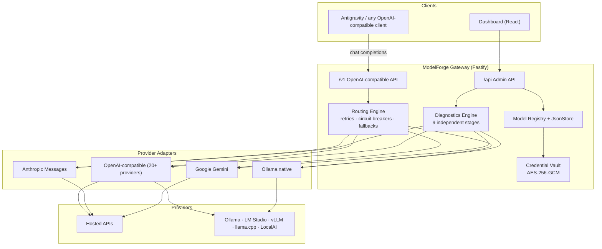

# Architecture

ModelForge is a modular monorepo. The gateway process serves three surfaces:
the OpenAI-compatible API (`/v1`), the admin API (`/api`) consumed by the
dashboard, and the built dashboard itself (`/ui/`).

## Packages

| Package | Responsibility |
|---|---|
| `@modelforge/shared-types` | Canonical domain types + normalized `ProviderError` |
| `@modelforge/security` | Encrypted vault, secret redaction, SSRF guard |
| `@modelforge/provider-sdk` | Adapter contract, HTTP helpers, error normalization |
| `@modelforge/provider-adapters` | Protocol adapters + provider catalog (data-driven) |
| `@modelforge/core` | Store, routing engine, diagnostics, service layer, GPU detection |
| `@modelforge/observability` | Structured logging, correlation ids, Prometheus metrics |
| `@modelforge/config` | Zod-validated environment configuration |
| `@modelforge/gateway` | Fastify server: `/v1`, `/api`, `/health`, `/metrics`, static dashboard |
| `@modelforge/dashboard` | React + Vite + Tailwind + TanStack Query + Zustand + Recharts |
| `@modelforge/antigravity` | Read-only Antigravity detection + gateway integration guidance |

## Request flow (chat)

1. Client calls `POST /v1/chat/completions` with a model name.
2. The routing engine resolves the name: exact id → alias → `chain:<id>` →
   `policy:<id>` → bare provider model id.
3. For each candidate target: circuit-breaker check → adapter call with
   bounded retries (retryable errors only) → fallback on failure.
4. Usage (tokens, latency, TTFT, estimated cost) is recorded; prompts and
   credentials are never logged.
5. Streaming uses SSE; if a stream fails after emitting tokens, the error is
   surfaced rather than silently switching providers mid-stream.

## Design principles

SOLID, explicit interfaces, dependency injection via constructor deps,
schema validation at every boundary (Zod), secure defaults, no silent
failures, no fake integrations. See [ADR-001](ADR-001-foundation.md).
